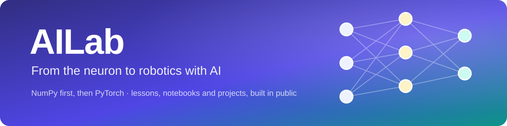
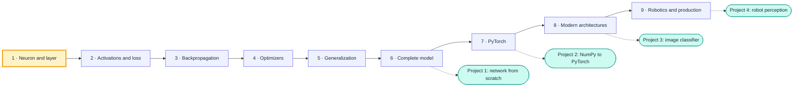

<p align="center"></p>

<p align="center"><sub>Created: 2026-11-23 · Last updated: 2026-11-23</sub></p>

<p align="center">
  
  
  
  
  
</p>

A public lab where I learn artificial intelligence, machine learning and robotics from first principles, and build projects I can show.

I work through neural networks in a deliberate order: first **from scratch in NumPy** (to understand what is inside), then **in PyTorch** (to work the way it is done in practice). Every lesson has a written goal, readings with page numbers, a notebook with diagrams, hand exercises and an exit test.

## 🗺️ Roadmap



🟡 in progress · 🟣 planned · 🟢 showcase project (dotted line: built at the end of that unit)

**Progress:** `░░░░░░░░░` 0 of 9 units completed · Unit 1 in progress

## 🎯 Goals

- Learn artificial intelligence (AI) and machine learning (ML)
- Learn robotics
- Build projects that can be shown

## 📁 Repository layout

```
AILab/
├── docs/        # conventions, lesson template and the study route (Spanish)
├── notebooks/   # one folder per lesson: README.md + notebooks (English)
├── src/         # reusable code (the from-scratch neural-network library)
└── projects/    # showcase projects (English)
```

Working rules are in [`docs/CONVENCIONES.md`](docs/CONVENCIONES.md).

> **Language.** Lessons in `notebooks/` and projects in `projects/` are in English. The personal study route in `docs/ruta/` (calendar, reading table, weekly plans) is in Spanish.

## 📚 Study route (Spanish)

- [General route](docs/ruta/ruta_aprendizaje_redes_neuronales.md)
- [Calendar with dates](docs/ruta/calendario.md): week by week, from November 23, 2026
- [Reading table](docs/ruta/tabla_lecturas.md): book, pages and objective of every reading
- [Week 1 plan](docs/ruta/U01_S01_2026-11-23_neurona-y-capa/U01_S01_2026-11-23_plan-neurona-y-capa.md)
- [Project plan](projects/README.md)

## ⚙️ Setup

Python 3.10 or newer.

```bash
pip install -r requirements.txt
jupyter lab
```

Every notebook also runs in Google Colab (the "open in Colab" link is in each lesson's `README.md`).

## 📈 Progress

| Unit | Lessons | Estimated dates | Status |
|---|---|---|---|
| 1. Neuron and layer | [Lesson 1](notebooks/U01_S01_2026-11-23_neurona-y-capa/README.md) | Nov 23 – Nov 29, 2026 | 🟡 In progress |
| 2. Activations and loss | | Nov 30 – Dec 20, 2026 | ⚪ Pending |
| 3. Backpropagation | | Dec 21, 2026 – Jan 10, 2027 | ⚪ Pending |
| 4. Optimizers | | Jan 11 – Jan 24, 2027 | ⚪ Pending |
| 5. Generalization | | Jan 25 – Feb 7, 2027 | ⚪ Pending |
| 6. A complete model | | Feb 8 – Feb 21, 2027 | ⚪ Pending |
| 7. PyTorch | | Feb 22 – Mar 21, 2027 | ⚪ Pending |
| 8. Modern architectures | | Mar 22 – Apr 25, 2027 | ⚪ Pending |
| 9. Robotics, generation and production | | Apr 26 – Jun 6, 2027 | ⚪ Pending |

Dates are targets, not promises. See the [calendar](docs/ruta/calendario.md) for how they were estimated.

## 📄 License

[MIT](LICENSE)
