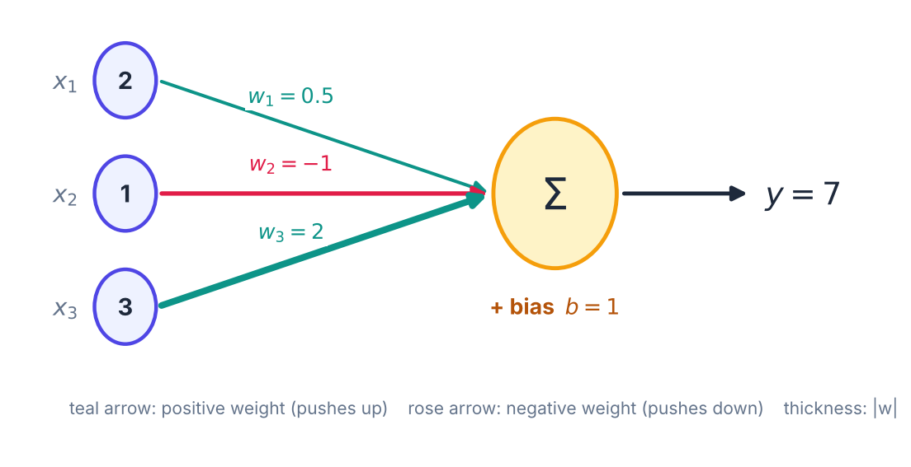
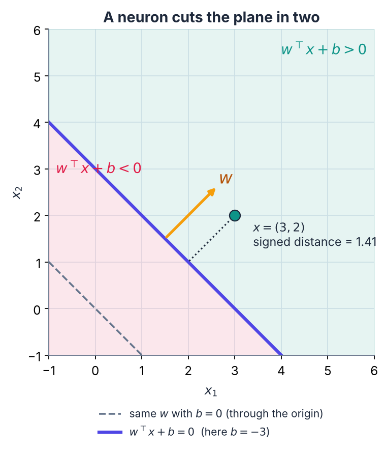
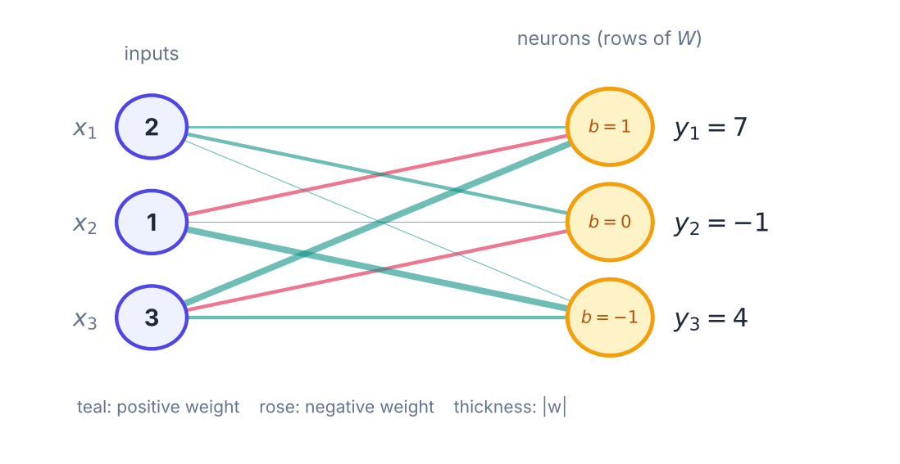
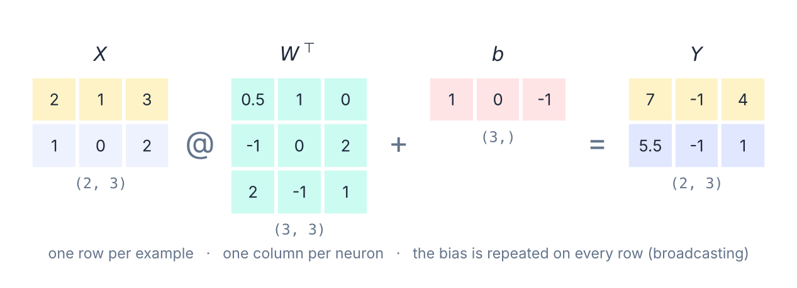

# 🧠 Lesson 1: from the neuron to the layer

*Created: 2026-11-23 · Last updated: 2026-11-23*

**Unit:** 1 · **Week:** 1 · **Dates:** Monday, November 23 to Sunday, November 29, 2026 · **Daily plan (in Spanish):** [`docs/ruta/U01_S01_2026-11-23_neurona-y-capa/U01_S01_2026-11-23_plan-neurona-y-capa.md`](../../docs/ruta/U01_S01_2026-11-23_neurona-y-capa/U01_S01_2026-11-23_plan-neurona-y-capa.md) · **Calendar (in Spanish):** [`calendario.md`](../../docs/ruta/calendario.md)

**Status:** started 2026-11-23 · due (exit test) 2026-11-29

> 🌐 Language note: the lessons in `notebooks/` are written in English. The study route, the reading table and the weekly plans in `docs/ruta/` are written in Spanish.

## 1. Goal

> Compute and program $y = Wx + b$ for a layer of neurons and for a batch of data, and explain in your own words what each symbol means and why the formula has this shape.

By the end you will be able to:

- Compute by hand the output of a neuron and of a layer.
- Explain a neuron as a **weighted vote** and a layer as an **affine transformation**.
- Program them in NumPy, from a plain loop down to a single line.
- Process a batch of data with $Y = XW^{\top} + \mathbf{1}\,b^{\top}$ and justify the transpose.

## 2. The idea

### The neuron
A neuron receives $n$ numbers $x_1,\dots,x_n$. Each one "votes" with a weight $w_i$: if $w_i>0$ it pushes the result up, if $w_i<0$ it pushes it down, and if $w_i\approx 0$ it barely matters. The votes are added and a fixed number $b$, the **bias**, is included:

$$y = \sum_{i=1}^{n} w_i x_i + b = w^{\top}x + b$$

The bias shifts the hyperplane $w^{\top}x + b = 0$. Without it, that hyperplane would always pass through the origin. In two dimensions that hyperplane is a line, and the neuron tells every point which side it is on and how far away it is:

### The layer
A layer is $m$ neurons that look at the **same** $n$ inputs, each with its own weights. The weights are stored in a matrix where **each row is one neuron**:

$$y = Wx + b, \qquad W\in\mathbb{R}^{m\times n},\; x\in\mathbb{R}^{n},\; b\in\mathbb{R}^{m},\; y\in\mathbb{R}^{m}$$

In linear-algebra terms: $x\mapsto Wx$ is a linear map and adding $b$ is a translation. Together they form an **affine** map.

### The batch
In practice $N$ examples are processed at once, stored as the rows of $X\in\mathbb{R}^{N\times n}$. Transposing $y_k = Wx_k + b$ gives $y_k^{\top} = x_k^{\top}W^{\top} + b^{\top}$, and stacking the $N$ rows:

$$Y = XW^{\top} + \mathbf{1}\,b^{\top}$$

### Why it matters later
Two affine layers in a row are equivalent to **a single one**: $W_2(W_1x+b_1)+b_2 = (W_2W_1)x + (W_2b_1+b_2)$. That is why the next lesson adds a **nonlinear** function between layers. Every network you will meet later, from a classifier to a transformer, is built by stacking layers like this one.

## 3. Readings

### Main reading

| Book | Pages | Learning objective |
|---|---|---|
| **Kinsley**, *Coding Our First Neurons* | 25–58 | See the neuron, the layer and the batch programmed in NumPy, and relate the dot product, the matrix product and the transpose to the notebook. |
| **Deisenroth (MML)**, 2.2 *Matrices* | 22–26 | Master, with rigor, matrix addition, multiplication and transposition. |
| **Deisenroth (MML)**, 3.2 *Inner Products* | 72–74 | Recognize the dot product $w^{\top}x$ as an inner product. |
| **Prince (UDL)**, 4.4 *Matrix notation* | 48 | See how a multi-layer network is written with matrices. |

### Support (optional)

| Book | Pages | Learning objective |
|---|---|---|
| **Prince (UDL)**, 2.1 and 2.2 | 17–21 | Understand that "learning" means adjusting parameters so that a model resembles the data. |
| **Goodfellow**, 2.1 and 2.2 | 29–33 | A second explanation of vectors, matrices and the matrix–vector product. |
| **D2L**, 2.3.8 to 2.3.10 | 48–49 | See the same operations in PyTorch. |
| **Deisenroth (MML)**, 2.7 *Linear Mappings* | 48–60 | Understand why $x\mapsto Wx$ is linear and why adding $b$ makes it affine. |
| **Bishop**, 6.2.1 *Parameter matrices* | 181 | The same layer seen from neural-network theory. |

Pages are the **printed** ones in each book. The offset to the PDF viewer is in [`docs/ruta/tabla_lecturas.md`](../../docs/ruta/tabla_lecturas.md) (in Spanish).

## 4. Notebook

- **Template:** [`S01_2026-11-23_neurona-y-capa.ipynb`](S01_2026-11-23_neurona-y-capa.ipynb) · [open in Colab](https://colab.research.google.com/github/mathsaicode/AILab/blob/main/notebooks/U01_S01_2026-11-23_neurona-y-capa/S01_2026-11-23_neurona-y-capa.ipynb)
- **Your solved version:** save it in this folder as `S01_2026-11-23_neurona-y-capa_resuelto.ipynb`.
- **Supporting theory:** [`U01_S01_2026-11-23_teoria-wx-b.md`](U01_S01_2026-11-23_teoria-wx-b.md) explains $y=Wx+b$ with numerical examples and 5 exercises.

Notebook structure: **Part A** (basic Python), **B** (the neuron), **C** (the layer), **D** (the batch) and **E** (summary).

## 5. Hand exercises

1. Compute $y=w^{\top}x+b$ with $x=(2,1,3)$, $w=(0.5,-1,2)$ and $b=1$. **Expected result: $7$.**
2. A neuron with $w=(1,1)$ and $b=-3$: which side of the line does the point $(3,2)$ fall on?
3. For $W=\begin{pmatrix}0.5&-1&2\\1&0&-1\\0&2&1\end{pmatrix}$, $b=(1,0,-1)$, $x=(2,1,3)$, compute $y$. **Expected result: $(7,-1,4)$.**
4. **Proof:** if $y_1=W_1x+b_1$ and $y_2=W_2y_1+b_2$, find $W'$ and $b'$ such that $y_2=W'x+b'$.
5. How many parameters does a layer with $784$ inputs and $10$ neurons have?

## 6. Exit test

Answer without looking at the book or the notebook:

- [ ] What are the dimensions of $x$, $W$, $b$ and $y$?
- [ ] What does each row of $W$ represent? And each column?
- [ ] Why is the layer affine and not linear?
- [ ] Why is $XW^{\top}$ used for a batch, and not $WX$?
- [ ] Why does stacking affine layers with nothing in between add nothing new?

## 7. Deliverable

- [ ] Solved notebook, with every check showing ✅, saved in this folder.
- [ ] Hand exercises 1 to 5 solved (photo or text, in `ejercicios/`).
- [ ] "My summary" section below completed.

## 8. My summary

> Write here, in your own words, what you learned. A lesson you cannot summarize is not finished.

**Today I learned…**

-
-
-

**What was hardest for me:**

-

## 9. What's next

**Lesson 2: activations and loss** (Weeks 2 to 4: November 30 to December 20, 2026). We add a nonlinear function between layers and a measure of error, so the network has something to improve.
